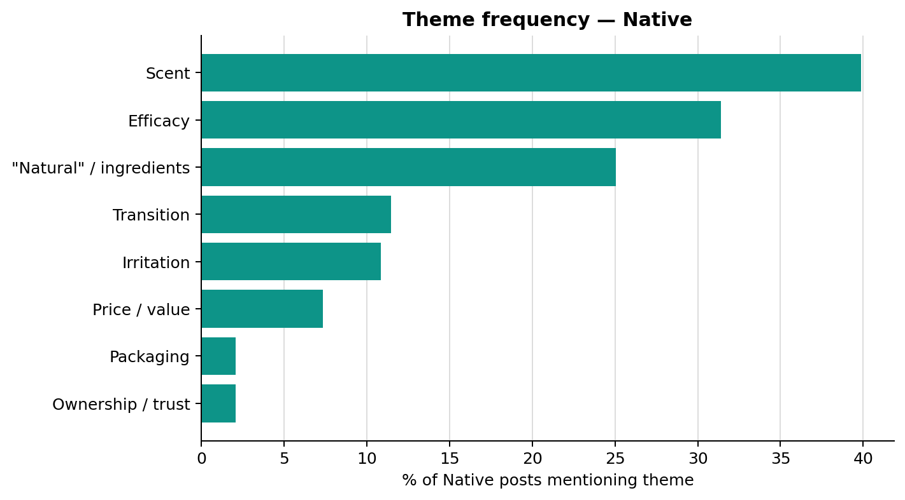
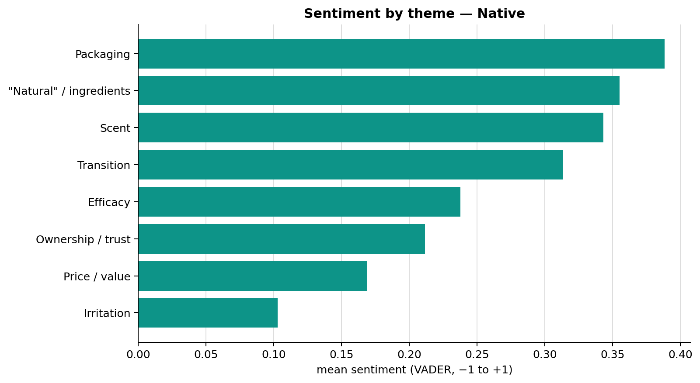
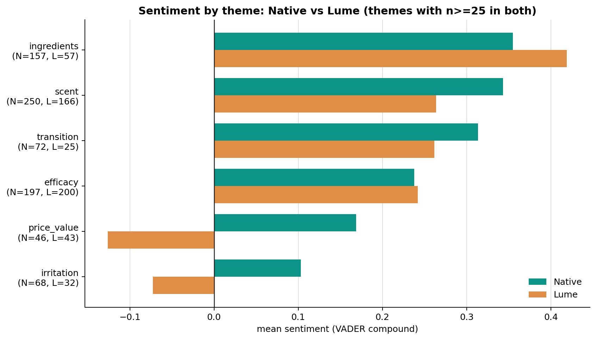
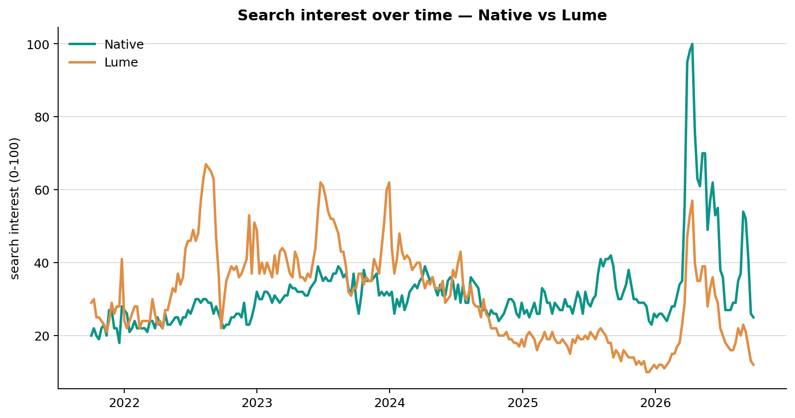
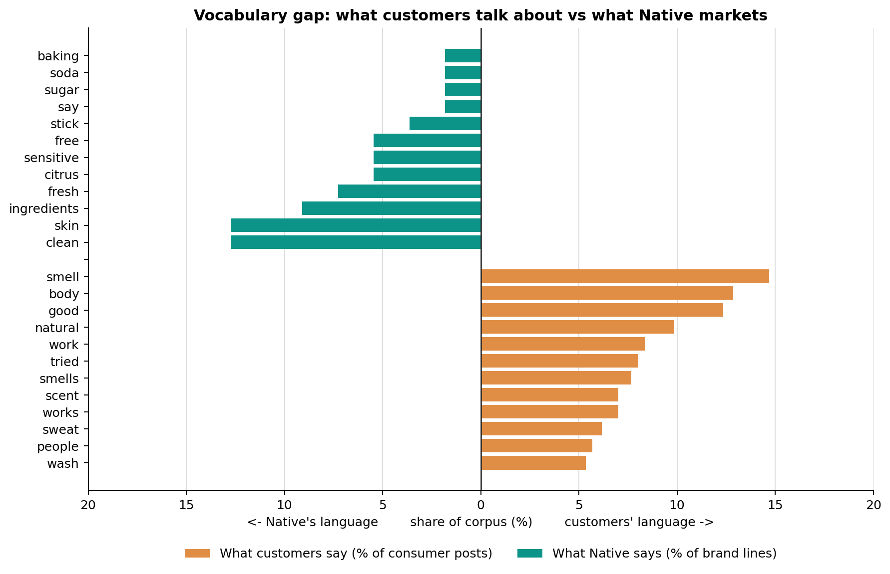

# Native Deodorant: Consumer Language Analysis

What consumers actually **say** about Native deodorant on social media — how that
compares with its closest competitor (**Lume**), how interest has moved over time,
and how far everyday consumer vocabulary sits from Native's own marketing language.

The analysis takes a corpus of social posts (Bluesky, YouTube), scores sentiment,
tags recurring themes, compares the two brands, tracks search interest, and
measures the gap between what customers talk about and what the brand markets.

## What's in here

```
.
├── analysis.py              # End-to-end pipeline (load → score → tag → compare → report)
├── requirements.txt
├── data/
│   ├── corpus_clean.csv     # Social posts: review_text, rating, date, source, brand
│   ├── trends.csv           # Weekly Google Trends interest (Native vs Lume, 0–100)
│   └── native_brand_copy.txt# Native marketing copy, one line per row
├── figures/                 # Pre-rendered charts (sample output)
└── notebooks/               # Step-by-step exploratory version (01–07) + shared helpers
```

## Quick start

```bash
pip install -r requirements.txt
python analysis.py
```

By default `analysis.py` reads from `./data` and writes charts + tables to
`./output`. You can point it elsewhere:

```bash
python analysis.py --data-dir path/to/data --output-dir path/to/output
```

The step-by-step notebooks in `notebooks/` reproduce the same analysis
interactively; run them from inside that folder (they import `shared.py`).

## The pipeline

1. **Load & clean** — merge social posts, drop Amazon reviews, remove blanks and duplicates.
2. **Score & tag** — VADER sentiment per post + keyword-based theme tagging.
3. **Native themes** — theme frequency and mean sentiment for Native.
4. **Native vs Lume** — theme share and sentiment, side by side.
5. **Search & time** — Google Trends interest and Native sentiment over time.
6. **Vocabulary gap** — consumer language vs Native brand copy.
7. **Findings** — a printed summary of the headline numbers.

## Selected charts

| | |
|---|---|
|  |  |
|  |  |



## Methodology notes & limitations

- **Sentiment** is VADER's compound score (−1 to +1). Posts ≥ +0.05 are *positive*,
  ≤ −0.05 *negative*, otherwise *neutral* (VADER's standard cutoffs). VADER is a
  general-purpose lexicon model and can misread sarcasm and domain-specific language.
- **Themes** are tagged by keyword matching, so a post can belong to several themes
  and theme percentages do not sum to 100. Most keywords match as word *prefixes*,
  which is broad but can occasionally over-match.
- **Theme sentiment** is the mean score of every post mentioning the theme, so it
  reflects the whole post rather than only the sentence about that theme.
- Social posts are a **self-selected sample** and are not representative of all
  Native customers. Small theme groups (n < 25) are excluded from the brand comparison.

## Note on tooling

This repository was prepared and committed with the help of
[Claude](https://claude.ai) (Anthropic). All work is published under the repository
owner's account.
